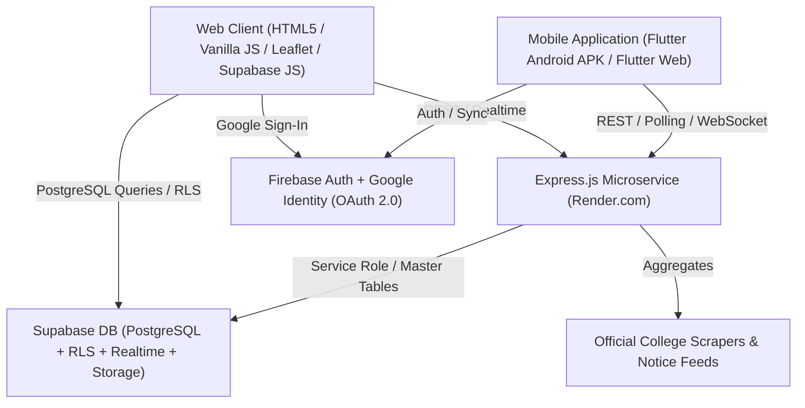
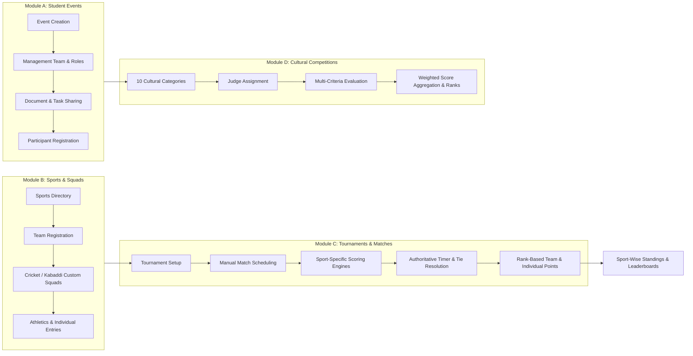

# GEC SHEIKHPURA STUDENT LIFE HUB – PROJECT MASTER MAP
**Document Version:** 2.0.0  
**Last Updated:** October 2026  
**Status:** Active Production Reference  
**Platform Scope:** Full-Stack Multi-Platform (Web Portal, Node.js/Express Backend, Supabase PostgreSQL, Flutter Android/Web App, Firebase Authentication & FCM)

---

## 1. PROJECT OVERVIEW & ARCHITECTURAL TOPOLOGY

The **GEC Sheikhpura Student Life Hub** is an engineering campus ecosystem designed specifically for Government Engineering College Sheikhpura (affiliated with Bihar Engineering University, Patna). It bridges campus living, student housing, local mess/tiffin services, verified local stores, peer lost & found, emergency helplines, official college circulars, and comprehensive **Sports, Tournaments, Cultural Competitions & Student Events Management**.

---

## 2. REPOSITORY & FILE-TO-FEATURE INVENTORY

### A. Root & Web Frontend Files (`/`)
| File | Role & Capabilities |
| :--- | :--- |
| `index.html` | Campus Landing Page, Quick Navigation, Emergency Quick-Bar, Live Notice ticker, Category shortcuts |
| `community.html` | Student Community Hub: College Events, Sports & Squads, Clubs & Societies, Campus Announcements |
| `login.html` | Zero-bounce Google OAuth & Student Email Authentication portal with fallback account picker |
| `admin.html` | Super Admin & Scoped Staff Management Portal (25+ administrative desks, RBAC, Moderation queues) |
| `rooms-pg.html` | Verified Student Housing, PG accommodations, Rent filters, Owner contact reveal |
| `food-tiffin.html` | Mess & Tiffin Services Directory, Meal plans, Delivery radii, Price filters |
| `explore-nearby.html` | Interactive Campus Map (Leaflet.js), Local Stores, Hostelite Laundry Booking Desk |
| `lost-found.html` | Campus Lost & Found Desk with secure claimant workflows and guard room drop notifications |
| `grievance.html` | Official Anti-Ragging & Grievance Redressal portal integrated with official Google Forms |
| `transport.html` | Sheikhpura Bus, Auto-Rickshaw, and Railway transit schedules and fare guides |
| `academics.html` | Academic Overview (routes study materials to partner portal *Apna College Bihar*) |
| `student-tools.html` | BEU SGPA/CGPA Calculators, 75% Attendance tracker, Syllabus viewer |
| `official-directory.html` | Faculty directory, Department heads, Lab technician contacts |
| `dashboard.html` | Student Profile, Bookmarked listings, ID card generator, Expense calculator |
| `gec-sheikhpura-hub.apk` | Production Lean Release APK (ARM64-v8a ~20.2 MB) |

### B. Assets & Core JavaScript Modules (`/assets/js/`)
| Script | Functional Responsibility |
| :--- | :--- |
| `assets/js/app.js` | Global UI shell, theme toggle, drawer navigation, user session header, notifications |
| `assets/js/auth.js` | Firebase Auth & Google Identity Services integration, zero-bounce account selector, JWT decoding |
| `assets/js/db-service.js` | Unified DB abstraction layer for Supabase PostgreSQL & Local Storage offline caching |
| `assets/js/community.js` | Phase 7 Community events, clubs, sports activity display, filter handlers |
| `assets/js/admin.js` | Admin dashboard event handling, approvals, laundry booking desk, RBAC tab gating |
| `assets/js/directory.js` | Housing, Mess, and Local Business grid rendering with dynamic price/distance filters |
| `assets/js/nearby-map.js` | Leaflet.js interactive map engine, GPS distance calculation from Bajidpur campus gate |
| `assets/js/data.js` | Master static metadata, college departments, emergency numbers, default transport routes |

### C. Backend API Service (`/server/`)
| File | Responsibility |
| :--- | :--- |
| `server/server.js` | Express.js API server, CORS configuration, Listings, Notices, Grievances, Laundry Orders, Admin RBAC |
| `server/package.json` | Dependencies: `express`, `cors`, `helmet`, `compression`, `dotenv` |

### D. Supabase Database Schema & Migrations (`/supabase/`)
| Migration | Scope |
| :--- | :--- |
| `schema.sql` | Base tables: profiles, categories, listings, reviews, bookmarks |
| `schema_phase7.sql` | Community events, event registrations, student clubs, sports activities, announcements |
| `schema_phase10.sql` | Moderation queues, directory corrections, audit trail |
| `schema_phase11.sql` | Owner listing submissions, verified badges, claim requests |
| `schema_phase12.sql` | Notification queues, push subscriptions, user preferences |
| `schema_sports_events.sql` | *(New - Master System)* Sports, Teams, Matches, Scoring, Tournaments, Cultural Competitions, Points |

### E. Mobile Flutter Application (`/mobile_app/`)
| Module | Responsibility |
| :--- | :--- |
| `lib/main.dart` | Application entrypoint, theme bootstrap, multi-provider state initialization |
| `lib/theme/app_theme.dart` | Campus Navy/Blue/Amber design tokens, typography, dark/light theme definitions |
| `lib/services/auth_service.dart` | Google Authentication, Student Identity verification, Session persistence |
| `lib/services/data_service.dart` | Network service for backend listings, circulars, lost & found, laundry orders |
| `lib/services/navigation_service.dart` | Deep-linking, bottom navigation bar coordinator, tab routing |
| `lib/models/models.dart` | Core data models (User, Room, Food, Shop, Notice, Event, Club, LostFound, LaundryOrder) |
| `lib/screens/home_screen.dart` | Home screen with Campus Notice banner, quick actions, emergency cards |
| `lib/screens/community_screen.dart` | Community & Campus Life: Events, Clubs, Sports Squads, Lost & Found, Announcements |
| `lib/screens/explore_screen.dart` | Nearby exploration and Hostelite Laundry Booking BottomSheet |
| `lib/screens/admin_panel_screen.dart` | Mobile administrative control panel with Role-Based Access Control |

---

## 3. SPORTS, EVENTS & TOURNAMENT MANAGEMENT ARCHITECTURE

The Sports & Events subsystem is structured across 4 tightly coupled modules governed by authoritative server-side validation and Supabase Realtime synchronization:

---

## 4. ROLE-BASED ACCESS CONTROL MATRIX

| Role | Scope & Permissions |
| :--- | :--- |
| **Platform / Super Admin** | Full root authority (`pk3334238@gmail.com`). Can manage all sports, approve sensitive management assignments, manage global platform settings. |
| **Sports Admin** | Configure sports, activate/deactivate disciplines, approve team registrations, assign referees & scorekeepers. |
| **Tournament Organizer** | Manually schedule matches, configure squad limits, resolve match ties with recorded reasons, publish official results. |
| **Event Head** | Full control over their created event. Appoint co-heads, assign coordinators, publish updates, manage document attachments. |
| **Event Manager / Coordinator** | Assigned specific permissions (viewing participants, managing registrations, updating schedules, managing tasks). |
| **Referee / Umpire** | Manage match lifecycle (Start, Pause, Resume, End), certify final score sheets, report disqualifications or infractions. |
| **Scorekeeper** | Realtime live score input (cricket ball-by-ball, kabaddi raid/tackle points, basketball quarters, volleyball sets). |
| **Judge** | Evaluate cultural participants across configured criteria (creativity, content, delivery, originality) with weighted scoring. |
| **Team Captain** | Submit team rosters, configure playing squads, request roster adjustments before organizer approval. |
| **Verified Student** | Register for events, join approved squads, claim lost items, view live scores and points tables. |
| **Spectator / Public** | Read-only access to public fixtures, ongoing live scores, and published tournament standings. |

---

## 5. REVENUE, PRIVACY & PRODUCTION COMPLIANCE
1. **Student Data Privacy**: Registration numbers, mobile phone numbers, and hostel room numbers are strictly masked from unverified users and public API endpoints.
2. **Authoritative State Transitions**: Match timers (especially Kabaddi 20m + 20m and Basketball quarters) use server timestamps rather than client timers to prevent clock manipulation.
3. **Audit Trail**: Every score correction, tie resolution, and administrative permission grant creates a timestamped record in `audit_logs`.

